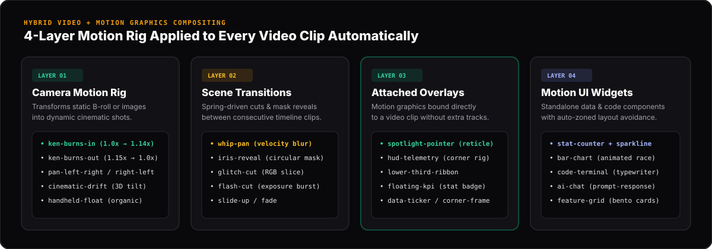

<div align="center">

# 🎬 AGVI Studio
### **The 100% MIT Programmatic Video & Hybrid Motion Graphics Engine for AI Agents**
*Trình dựng Video & Motion Graphics mã nguồn mở chuẩn doanh nghiệp dành riêng cho AI Agent (Zero Remotion)*

[](./LICENSE)
[](./docs/ARCHITECTURE.md)
[](./src/lib/anti-slop/anti-slop-filter.ts)
[](./package.json)

[**🇻🇳 Tài liệu Tiếng Việt**](./docs/VIETNAMESE_GUIDE.md) • [**📐 System Architecture**](./docs/ARCHITECTURE.md) • [**🤖 AI Agent API Guide**](./docs/AGENT_API_GUIDE.md) • [**✨ Motion Effects Catalog**](./docs/HYBRID_MOTION_EFFECTS.md)

</div>

---


---

## 💡 What is AGVI Studio? (Dự án này là gì?)

**AGVI Studio** (**A**gentic **G**enerative **V**ideo **I**nterface) is a web-based Non-Linear Video Editor (NLE) and deterministic rendering engine designed so **AI Agents (Claude, GPT, Gemini, MCP) and humans can collaborate on broadcast-grade videos using simple JSON actions.**

> **🇻🇳 Tóm tắt cho người mới:**
> Thay vì phải mở Premiere/After Effects chỉnh từng keyframe hoặc bị kẹt giấy phép thương mại của Remotion, **AGVI Studio** cung cấp một trình dựng video chạy trực tiếp trên trình duyệt kèm **REST API cho AI Agent**. Chỉ với **1 lệnh gọi API** (`enhance_video_with_motion` hoặc `generate_from_prompt`), AI có thể tự động ghép video thường với chuyển động Camera (Ken Burns), hiệu ứng chuyển cảnh (Whip-Pan, Glitch, Iris), lớp phủ thông số HUD/Spotlight, biểu đồ KPI động và âm thanh SFX mà **không bao giờ bị đè chữ hay lòe loẹt**.

### Why AGVI Studio vs. Existing Tools?

| Capability | Traditional NLEs (Premiere / CapCut) | Remotion | Generic Text-to-Video AI (Sora / Runway) | **AGVI Studio** |
| :--- | :--- | :--- | :--- | :--- |
| **Commercial License** | Paid Subscription | Proprietary Company License | Paid Credits | **100% Free MIT License** |
| **AI Agent Controllability** | ❌ Manual GUI only | ⚠️ Requires writing & compiling React code | ❌ Black-box pixel diffusion | **✅ Instant REST JSON Actions** |
| **Hybrid Video + Motion Rig** | ⚠️ High manual keyframe effort | ⚠️ Manual math per component | ❌ Hallucinates garbled text | **✅ 1-Call `enhance_video_with_motion`** |
| **Typography & Data Charts** | Manual layout | Manual CSS | ❌ Cannot render crisp charts/code | **✅ Crisp Vector KPI, Charts & Code** |
| **Anti-Slop Layout Guardrails**| ❌ None | ❌ None | ❌ Prone to visual clutter | **✅ Context-Aware Zero-Overlap Solver** |

---

## 🏗️ How It Works — End-to-End Architecture


1. **AI Director / Agent API (`/api/agent/actions`)**: Accepts natural language prompts or structured atomic mutations from any LLM or script.
2. **Anti-Slop Sanitizer (`src/lib/anti-slop/anti-slop-filter.ts`)**: Automatically strips AI clichés, enforces high-craft editorial palettes (Dark-Room `#09090B` & Warm Paper `#F7F6F2`), caps scene density at 2 concurrent visual cards, and prevents coordinate collisions.
3. **Hybrid Video + Motion Compositor (`src/components/remotion/AGVIComposition.tsx`)**: Binds Camera Rigs, Transitions, and Motion Overlays directly onto raw video clips while solving responsive zones across `16:9`, `9:16`, and `1:1`.
4. **100% MIT Native Frame Engine (`src/lib/engine/agvi-engine.tsx`)**: Drives deterministic `useCurrentFrame()`, critically damped `spring()` physics, procedural Web Audio API soundtracks/SFX, and client-side WebM/MP4 video recording.

---

## ✨ 4-Layer Hybrid Video + Motion Graphics System



Instead of requiring an AI Agent to calculate complex multi-track keyframes, **AGVI Studio** lets any `video` or `image` clip declare its own motion rig directly in JSON:

```json
{
  "id": "clip-vid-1",
  "type": "video",
  "title": "Scene 1 • Architecture Footage",
  "startTime": 0,
  "duration": 4,
  "cameraMotion": "ken-burns-in",
  "sceneTransition": "whip-pan",
  "motionOverlay": "spotlight-pointer",
  "overlayTitle": "01 / CORE TELEMETRY",
  "overlayMetric": "60 FPS NATIVE"
}
```

| Layer | Property | Built-in Presets |
| :--- | :--- | :--- |
| **1. Camera Rig** | `cameraMotion` | `ken-burns-in`, `ken-burns-out`, `pan-left-right`, `pan-right-left`, `cinematic-drift`, `handheld-float` |
| **2. Scene Cut** | `sceneTransition` | `whip-pan`, `iris-reveal`, `glitch-cut`, `flash-cut`, `slide-up`, `fade` |
| **3. Video Overlay** | `motionOverlay` | `spotlight-pointer`, `hud-telemetry`, `lower-third-ribbon`, `floating-kpi`, `data-ticker`, `corner-frame` |
| **4. Data Widgets** | `type` | `stat-counter`, `bar-chart`, `code-terminal`, `ai-chat`, `feature-grid`, `waveform`, `caption` |

👉 See the full visual catalog in [**`docs/HYBRID_MOTION_EFFECTS.md`**](./docs/HYBRID_MOTION_EFFECTS.md).

---

## 🛡️ Anti-Slop Design Guardrails


Inspired by the [Anti-Slop Design Manifesto](https://github.com/miqdadbadjuber/anti-slop), AGVI Studio enforces studio-grade restraint at the compiler level:
- **Zero Neon Gradient Soup**: Automatically replaces harsh cyan/magenta gradients with curated **Editorial Dark-Room** (`#09090B` + `#10B981` Emerald / `#F59E0B` Amber) or **Warm Editorial Paper** (`#F7F6F2` + `#E11D48` Vermilion) tokens.
- **Zero Text Collisions (`ActiveSceneLayoutContext`)**: Dynamically partitions the canvas into non-overlapping Upper-Left, Lower-Left, and Right-Stage zones whenever headlines, spotlight callouts, and data widgets co-exist in the same scene.
- **Tabular Numerals & Crisp Physics**: Enforces `font-variant-numeric: tabular-nums` on all counters/timers and 150ms–300ms critically damped springs.

---

## 🚀 Quick Start (Chạy dự án trong 60 giây)

### 1. Clone & Install

```bash
git clone https://github.com/baobao1044/agvi-studio.git
cd agvi-studio
npm install
npm run dev
```

Open **[http://localhost:3000](http://localhost:3000)** in Chrome, Edge, or Brave.

### 2. Try the Studio Features Immediately
1. **Magic AI Prompt Bar (Top Center)**: Type any topic in English or Vietnamese (e.g., *"Tạo video 16s giới thiệu nền tảng AI Agent với biểu đồ tốc độ và terminal"*) and click **Generate**.
2. **✦ Auto-Enhance Video (Top Toolbar)**: Click the amber **Auto-Enhance Video** button to inject Camera Rigs, Whip-Pan transitions, HUD Telemetry, and Spotlight Callouts across the entire timeline in 1 click.
3. **Interactive 6-Track Timeline**: Drag clips to move `startTime`, drag left/right edges to trim `duration`, press `Space` to play with real-time synthesized music & transition whoosh SFX, or press `S` to split a clip at the playhead.
4. **Export Video**: Click **Export Video** in the top-right corner to record and download a `.webm` / `.mp4` video file directly from your browser.

---

## 🤖 Controlling AGVI Studio from an AI Agent

### 1. One-Call Auto-Enhancer (`enhance_video_with_motion`)

```bash
curl -X POST http://localhost:3000/api/agent/actions \
  -H "Content-Type: application/json" \
  -d '{
    "action": "enhance_video_with_motion",
    "payload": {
      "style": "tech-hud",
      "transitionStyle": "whip-pan",
      "addSoundEffects": true
    }
  }'
```

### 2. Generate a Multi-Track Storyboard from Natural Language (`generate_from_prompt`)

```bash
curl -X POST http://localhost:3000/api/agent/actions \
  -H "Content-Type: application/json" \
  -d '{
    "action": "generate_from_prompt",
    "payload": {
      "prompt": "Explain how zero-Remotion video rendering works in 4 scenes with KPI counters and code terminal",
      "aspectRatio": "16:9",
      "duration": 16
    }
  }'
```

### 3. Inspect Full Agent Schema & Capabilities

```bash
curl http://localhost:3000/api/schema
```

👉 Read the complete API reference and TypeScript integration examples in [**`docs/AGENT_API_GUIDE.md`**](./docs/AGENT_API_GUIDE.md).

---

## 📂 Repository Structure

```text
agvi-studio/
├── public/docs/                          # Vector SVG architectural & UI illustrations
│   ├── agvi-hero-banner.svg              # Full NLE Studio & 16:9 Stage preview
│   ├── agvi-architecture-pipeline.svg    # 4-Step Agent-to-Video pipeline diagram
│   ├── agvi-hybrid-motion-showcase.svg   # 4-Layer Hybrid Motion Graphics diagram
│   └── agvi-anti-slop-comparison.svg     # Anti-Slop vs Generic AI Video comparison
├── docs/                                 # Comprehensive Developer & User Documentation
│   ├── VIETNAMESE_GUIDE.md               # Hướng dẫn toàn diện bằng Tiếng Việt
│   ├── ARCHITECTURE.md                   # Native MIT Frame Engine & Layout Solver
│   ├── AGENT_API_GUIDE.md                # REST API cookbook for LLMs & Agents
│   └── HYBRID_MOTION_EFFECTS.md          # Reference for Camera, Transitions & Overlays
├── src/
│   ├── lib/
│   │   ├── engine/agvi-engine.tsx        # 100% MIT Frame Clock, Spring, Player & Exporter
│   │   ├── schema/timeline-schema.ts     # Deterministic JSON Schema & TypeScript types
│   │   ├── schema/starter-templates.ts   # 4 Showcase Templates (AI, TikTok, Terminal, Launch)
│   │   ├── anti-slop/anti-slop-filter.ts # Aesthetic & layout density guardrails
│   │   ├── audio/procedural-sound-engine.ts # Web Audio API synth music & transition SFX
│   │   └── server/project-store.ts       # AI Director compiler & atomic state reducer
│   ├── components/
│   │   ├── remotion/AGVIComposition.tsx  # Hybrid Video + Motion Graphics scene compositor
│   │   └── studio/                       # NLE Studio UI (Timeline, Inspector, Agent Panel)
│   └── app/api/                          # REST API Routes (/agent/actions, /schema, /render)
└── LICENSE                               # 100% MIT License
```

---

## 📄 License

Distributed under the **MIT License**. See [`LICENSE`](./LICENSE) for full details. Free for commercial, SaaS, and enterprise deployment.
