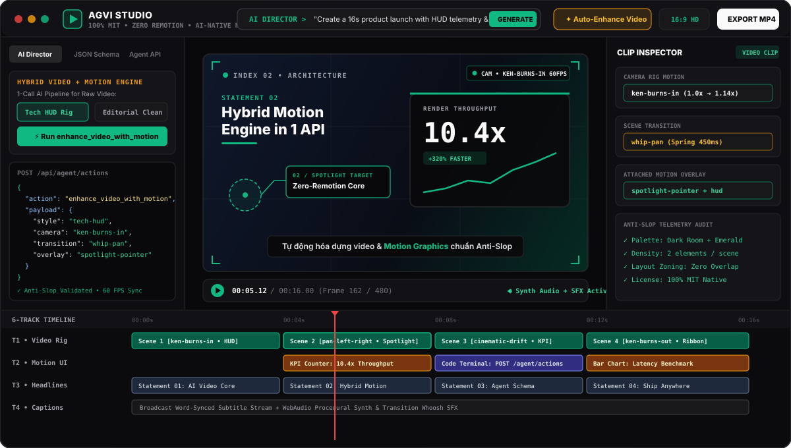
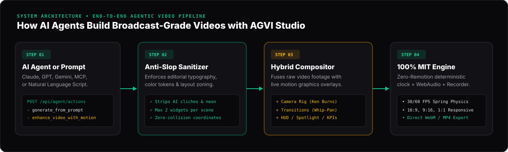
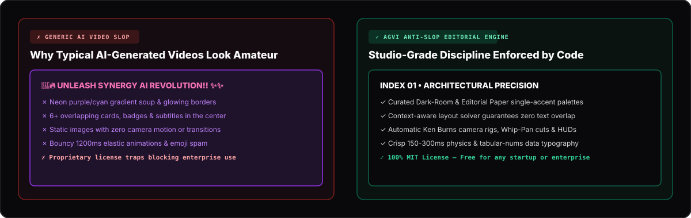

# Tài Liệu Hướng Dẫn Toàn Diện — AGVI Studio (Tiếng Việt)



## 1. AGVI Studio là gì? Tại sao dự án này ra đời?

Khi bạn yêu cầu một AI Agent (như Claude, GPT, Gemini) tự động dựng một video giới thiệu sản phẩm, video tin tức công nghệ hoặc video ngắn TikTok/Reels, bạn thường gặp **3 rào cản lớn**:

1. **Rào cản Bản quyền (License Trap)**: Các thư viện dựng video bằng React phổ biến (như Remotion) sử dụng giấy phép độc quyền thu phí doanh nghiệp. Bạn không thể thoải mái đóng gói vào sản phẩm SaaS thương mại hoặc hệ thống nội bộ công ty.
2. **Rào cản "Rác thị giác AI" (AI Slop)**: Video do AI tự sinh thường lòe loẹt màu tím/hồng neon, chữ đè lên nhau ở giữa màn hình, lạm dụng icon/emoji và hiệu ứng nảy lò xo rối mắt.
3. **Độ phức tạp khi ghép Video thường với Motion Graphics**: Để AI tự căn chỉnh từng khung hình (keyframe), tự vẽ tâm ngắm, bảng số liệu (KPI Card), chuyển cảnh (Transition) và lồng tiếng động (SFX) đòi hỏi hàng trăm dòng JSON phức tạp.

👉 **AGVI Studio giải quyết trọn vẹn cả 3 vấn đề trên:**
- **100% MIT License (Zero Remotion)**: Tự xây dựng **Native Frame Engine** riêng (`src/lib/engine/agvi-engine.tsx`), hoàn toàn miễn phí cho cả cá nhân, startup lẫn doanh nghiệp thương mại.
- **Tích hợp bộ lọc Anti-Slop tự động**: Ép buộc chuẩn thiết kế biên tập cao cấp (Editorial Dark-Room / Warm Paper), giới hạn tối đa 2 thành phần chính mỗi cảnh và tự động chia vùng chống đè chữ 100%.
- **1 Lệnh API duy nhất (`enhance_video_with_motion`)**: Biến video thô thành video có sẵn chuyển động Camera (Ken Burns), chuyển cảnh (Whip-Pan, Iris, Glitch), lớp phủ HUD/Spotlight và âm thanh SFX.

---

## 2. Kiến trúc hoạt động từ AI Agent đến file Video MP4/WebM



1. **Bước 1 — Nhận lệnh từ AI Agent hoặc câu lệnh tự nhiên**: Gửi prompt tiếng Việt/tiếng Anh vào thanh **AI Director** hoặc gọi REST API `POST /api/agent/actions`.
2. **Bước 2 — Kiểm duyệt Anti-Slop (`anti-slop-filter.ts`)**: Tự động lọc bỏ từ ngữ sáo rỗng, chuyển các mã màu neon chói sang bảng màu chuẩn studio, và kiểm tra mật độ hiển thị.
3. **Bước 3 — Hòa trộn Hybrid Video + Motion Graphics (`AGVIComposition.tsx`)**: Kết hợp video nền với 4 lớp hiệu ứng động và tự động tính toán tọa độ chống va chạm (`ActiveSceneLayoutContext`).
4. **Bước 4 — Kết xuất khung hình & Âm thanh (`agvi-engine.tsx`)**: Đồng bộ 30/60 FPS cùng bộ tổng hợp âm thanh Web Audio API và xuất trực tiếp ra file `.webm` / `.mp4`.

---

## 3. So sánh Video AI thông thường và AGVI Anti-Slop Engine



---

## 4. Hướng dẫn chạy dự án trong 60 giây

### Yêu cầu hệ thống
- **Node.js**: `>= 20.x`
- **Trình duyệt**: Chrome, Edge, hoặc Brave (hỗ trợ xuất video tốc độ cao qua `MediaRecorder`)

### Cài đặt & Khởi chạy

```bash
# 1. Clone dự án
git clone https://github.com/baobao1044/agvi-studio.git
cd agvi-studio

# 2. Cài đặt thư viện
npm install

# 3. Chạy máy chủ phát triển
npm run dev
```

Mở trình duyệt tại **[http://localhost:3000](http://localhost:3000)**:
- Bấm nút **✦ Auto-Enhance Video** màu vàng trên thanh công cụ để xem AI tự động gắn Camera Rig + Chuyển cảnh + HUD Telemetry + Spotlight vào toàn bộ video.
- Nhập câu lệnh bất kỳ vào ô **Magic Prompt** ở trên cùng và bấm **Generate** để AI tạo kịch bản 6-track mới.
- Bấm **Export Video** ở góc phải trên cùng để xuất thành file video thực tế.
